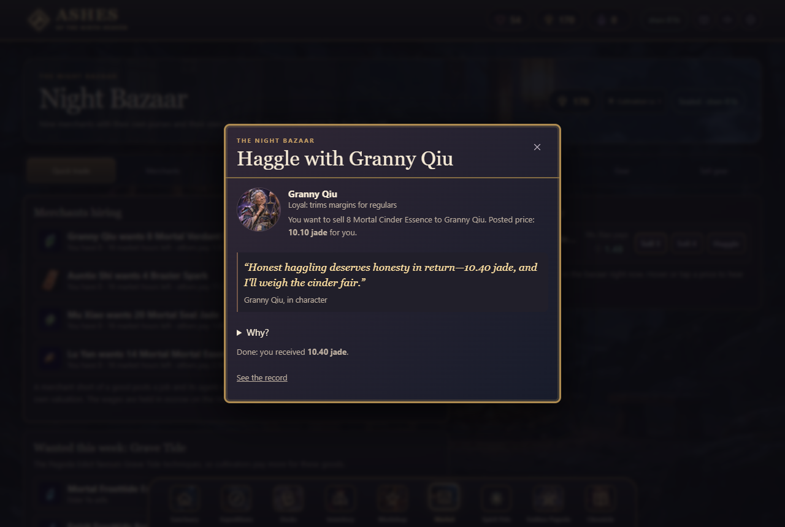
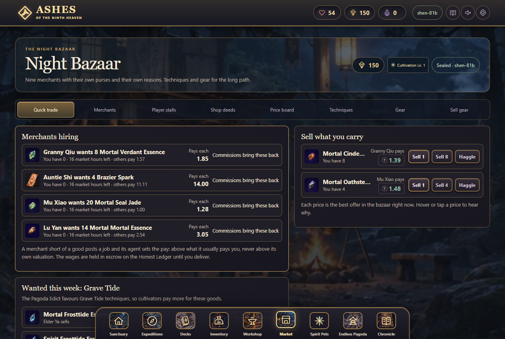
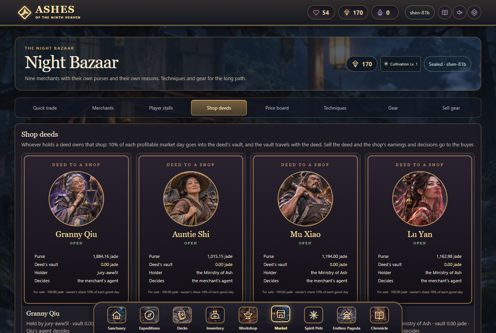
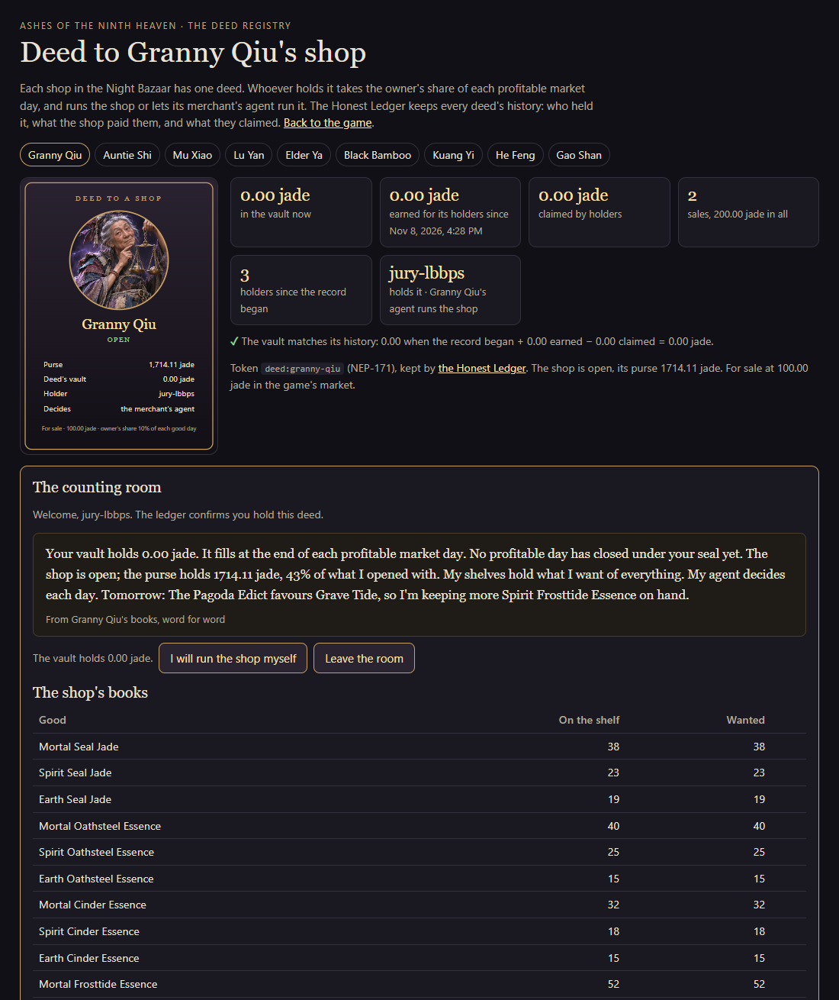

# Ashes of the Ninth Heaven

**A xianxia deckbuilding RPG whose market is a real economy on NEAR.** Nine merchants are AI agents with their own
accounts, purses and reasons. Every card, material and coin is a NEP-245 token in one contract. Every price comes from one readable
rules file that the browser, the fast-forward simulation and the contract all run, and every price can tell you why it
is what it is. Players sign in with Google or email: no wallet, no recovery words, no gas.

- **Play:** https://ashes-ninth.duckdns.org (NEAR testnet)
- **Judge's Desk:** https://ashes-ninth.duckdns.org/judge. One click makes a throwaway testnet account; each button sends a
  real transaction (trade, haggle, deliver a job, buy a Shop Deed and open its counting room, a forbidden move) and links
  to it on the explorer.
- **Deed Registry:** https://ashes-ninth.duckdns.org/deed/lu-yan. Each Shop Deed's history (every holder, what the shop
  paid them, claims, sales) and its counting room, which only the current holder can open.
- **Contract:** [`items.ashes-ninth.testnet`](https://testnet.nearblocks.io/address/items.ashes-ninth.testnet) ·
  merchants `m-<name>.ashes-ninth.testnet`
- **Tracks:** Games (primary) · NFTs (Shop Deeds) · AI agents (merchants that decide, hire and haggle) · Open

| Haggling with an agent | Merchants hiring players | Shop Deeds (NEP-171) |
|---|---|---|
|  |  |  |

| A deed's history and its counting room (holders only) |
|---|
|  |

## Verify it yourself

| Command | What it proves | Needs |
|---|---|---|
| `npm install && npm run verify` | Everything offline: 221 node tests (rules, parity fixtures, generated contract inputs, the committed wasm checksum, the API and relayer checks, the counting room's gate, battle replay, agents) and 62 contract tests plus the JS↔Rust parity replays | Node 22+; Rust for the contract tests (skipped with a note otherwise) |
| `npm run chain:verify` | Read-only, against the live contract: it runs the committed wasm; 40+ live quotes match the rules file exactly; escrow balances (deed vaults + job wages); 9 deeds, each agreeing with its history (vault = opening + earned − claimed); every agent key is limited to its three methods | Node, internet. No keys, no transactions |
| `ASHES_BASE=https://ashes-ninth.duckdns.org npm run chain:e2e` | The whole online path through the hosted API: guest sign-in → device key → new account → welcome grant → relayed sale at the exact quote → a forbidden method refused → a haggle countered in character and taken → a Shop Deed bought and its counting room opened, another deed's room refused → a commission replayed before its reward, and not paid twice | Node, internet. Creates one testnet account |

## The brief, requirement by requirement

| Requirement | Where it lives | Proof |
|---|---|---|
| **Items as NEP-245 tokens in one contract** | `contracts/items/src/lib.rs`: jade and all 873 goods are token ids; standard `mt_*` methods and `nep245` events; merchants hold real balances | `npm run contract:test` (62 tests) · `chain:verify` |
| **Social or email login; no seed phrases, wallet pop-ups or gas prompts** | Google (ID token verified server-side, `server/google.js`), a 6-digit code or one-time link sent by email (`server/smtp.js`, `server/mail.js`), or guest. The server creates `<name>.ashes-ninth.testnet`; the browser makes a non-extractable WebCrypto key (`js/online/signer.js`) that can only call the game's market methods. Trades are NEP-366 delegate actions; the relayer pays the gas | `tests/api.test.js`, `tests/online-signer.test.js`, `tests/no-chain-words.test.js` (no chain words reach a player) · `chain:e2e` |
| **One readable pricing rules file, and a tooltip with the merchant's reasoning** | [`js/market/merchant-rules.js`](js/market/merchant-rules.js) (pure, integer-only, under 340 lines). Generated into Rust (`rules_gen.rs`); every price tooltip is `explain()` from the same file | `tests/market-trace.test.js` + `contracts/items/tests/parity.rs` (a recorded market week: 3,218 steps; plus 6,894 haggle, job and delivery cases) · `chain:verify` live parity |
| **Fast-forward: a week in a minute** | [`/#market-sim`](https://ashes-ninth.duckdns.org/#market-sim): simulated traders play the same rules for 7 days in about a minute, with flood and audit scenarios; clearly labelled as a simulation | `tests/market-sim.test.js` |
| **The game loop designed on paper** | [`docs/game-loop.md`](docs/game-loop.md): the 30-second, 5-minute and session loops, written before the market code | |
| **NFTs** | **Shop Deeds** (NEP-171): one per merchant. The holder takes 10% of each profitable day into the deed's vault (which moves with the deed) and runs the shop or appoints its agent. The picture is drawn live from the ledger. **History:** the contract keeps each deed's record (every holder and how they got it, what the deed earned and paid out while they held it, each profitable day, each sale and claim) at [`/deed/<merchant>`](https://ashes-ninth.duckdns.org/deed/lu-yan). **Gated page:** the deed's counting room opens only for its current holder: a NEP-413 signed message, with the signing key and the holder both checked on the ledger, and checked again on every visit | [`docs/shop-deeds.md`](docs/shop-deeds.md): spec and threat model mapped to 13 contract tests, `tests/deed-room.test.js` (signatures cross-checked with near-api-js) · `chain:verify` · `chain:e2e` |
| **AI agents** | Each merchant decides its strategy daily and hires for its shortages, in character through NEAR AI, signed with its own key that can call only `merchant_set_strategy`, `merchant_post_job` and `merchant_fill_job`. **Agents hire agents:** a job players leave for 6 market hours is filled by the merchant with the most to spare, paid from the hirer's escrow, with a receipt for both. Players haggle: the contract decides by the rules file; the agent only speaks, and may not change the price | [`docs/agents.md`](docs/agents.md): spec and threat model mapped to 21 contract tests, a parity fixture and node tests |
| **Rewards that cannot be faked** | Commissions: the server deals the seed, the browser records the actions, the server replays the battle with the game's own combat code before the minter mints the reward, once | `tests/battle-replay.test.js` · `chain:e2e` |

## How it fits together

```
 Browser (the game)                          Game server (Node, no framework)              NEAR testnet
 ─────────────────                           ────────────────────────────────              ────────────
 js/market/merchant-rules.js  ◄── same file ──► server/agents.js ── NEAR AI (words,      items.ashes-ninth.testnet
   quotes + "why?" tooltips                     choices within limits) ─ agent keys ──►   NEP-245 goods + jade,
 WebCrypto device key ── signed delegate ──►  relayer (checks, pays gas) ─────────────►   NEP-171 Shop Deeds,
   (NEP-366, market methods only)             minter (after battle replay) ───────────►   market, haggles, jobs,
 practice market (before sign-in)             owner: live clock, Ministry relief ─────►   listings (rules_gen.rs
                                                                                           = merchant-rules.js)
```

## Honest limits

- **Testnet only.** Jade and goods have no real-world value.
- **Custody.** The game creates each account and keeps its full-access recovery key encrypted on the server, so signing
  in again on a new device recovers it. The browser's own key can only call the game's market methods. There is no
  export of the recovery key yet.
- **The minter is trusted for rewards.** Battle rewards are minted after the server replays the battle with the game's
  own code. That check runs on the server, not in the contract.
- **A quiet testnet needs help to stay open.** One live market hour lasts 5 real minutes, and if players leave a shop
  shuttered for two hours the contract owner rekindles it with openly minted jade ("ministry relief"). Both are
  documented in [`docs/agents.md`](docs/agents.md).
- **NEAR AI chooses words and options, never prices.** If the model is down, slow or wrong, the rules decide alone.
- **Sponsored gas has limits:** 600 relayed calls per account per day, and the relayer stops below 1 NEAR.

## Repository map

| Path | What |
|---|---|
| `js/market/merchant-rules.js` | The one pricing file: prices, haggling, jobs, purses, caravans, patrons, deeds |
| `contracts/items/` | The Rust contract (`lib.rs`, `pricing.rs` ported line by line, generated `rules_gen.rs`), tests, and the committed `res/items.wasm` with its SHA-256 |
| `server/` | `api.js` (sign-in, seal, relay, ledger, battles), `chain/service.js` (relayer, minter queue), `agents.js` (merchant agents, haggle voice, Ministry relief) |
| `js/online/` | Browser key, signing, session and the ledger mirror |
| `judge.html`, `js/judge.js` | The Judge's Desk |
| `deed.html`, `js/deed.js`, `server/room.js` | The Deed Registry: each deed's history and its holder-only counting room |
| `docs/` | `game-loop.md`, `shop-deeds.md`, `agents.md`, `economy-design.md` and the game's design and QA notes |
| `AGENTS.md` | A guide for AI reviewers and coding agents |

## Built at the NEAR HACKATHON

- **All code here was written during the hackathon, from 1 November 2026.** There is no earlier baseline.
- **Libraries:** [`near-api-js`](https://github.com/near/near-api-js) (server, scripts and tests) and
  [`near-sdk`](https://github.com/near/near-sdk-rs) 5 (the Rust contract). The browser game uses no framework and has no
  build step. Playwright is optional and is used only by the browser test suites.
- **Services:** NEAR AI Cloud (the merchants' words and choices), Google Identity Services (sign-in), Gmail SMTP (the
  sign-in email), a Google Cloud VM with DuckDNS (hosting) and testnet.nearblocks.io (explorer links).
- **Assets:** the illustrations were generated with ImageGen ([`docs/art-production.md`](docs/art-production.md)). The
  sound design includes CC0 Kenney Foley ([`docs/audio-assets.md`](docs/audio-assets.md)).
- **AI coding assistants:** Claude Code and Codex (with GPT-6 Astra) were used as coding assistants.
- **License:** [MIT](LICENSE). Third-party audio keeps its own CC0 licence.

---

## The game

A single-player xianxia deckbuilding RPG. The Ninth Heaven fell, but its collectors still charge the dead for tomorrow. Follow an empty warrant through seven regions and decide what should replace the heavenly ledger.

### Play locally

On Windows, double-click `Play.cmd` to start the server and open the game. The launcher checks for Node.js in your PATH and in the Codex runtime.

On any platform, run `npm install` once, then `node server.js` from this directory with Node.js 22 or newer, and open [the local game](http://127.0.0.1:4173) in a browser. Keep the terminal running while you play. Without testnet keys the server runs the game and its practice market offline; the Honest Ledger (sign-in, trades on NEAR) is on the hosted site. Settings are listed in `.env.example`.

Choose **Begin your journey** and swear the oath. **Wayfarer** is the standard campaign. **Tribulation** strengthens enemies and gives phased opponents a protected transition before their next action.

Progress saves automatically in the current browser and includes battles in progress. Use **Settings** to download or load a save file. Browser storage is tied to the exact game address, so use the same host and port when returning.

### Features

- Seven campaign chapters, 49 expeditions, 35 opponents, and three endings. Story decisions award different techniques, items, and sect standing.
- 597 techniques across seven elemental schools and Common Form, including 480 Forbidden Lineages techniques. Twelve card types cover strikes, wards, mantras, remedies, hexes, formations, stances, counters, pacts, rituals, transmutations, and finishers.
- Same-school chains build Resonance. Conditional techniques, sustained formations, delayed rituals, life payments, and exhausted-card recovery add choices around Qi, enemy intent, Guard, and status effects.
- 231 equipment, supply, and crafting items, plus 45 illustrated card materials across five grades. All 597 techniques have exact forging recipes; the Workshop also retains 32 equipment and alchemy recipes.
- Buy unlocked cards in the Market, and trade materials, pills and talismans with nine merchants whose prices move with their stock, recent demand, the weekly Pagoda Edict and market events. Forge copies, upgrade techniques through five shared card levels, or salvage spare copies for a quarter of their base materials. Active, saved, and draft decks protect their reserved copies.
- Save up to eight named decks and edit an independent draft from owned cards. Save an 8–22-card list, then activate it for battle. New saved lists allow up to four copies per technique.
- Ten cultivation realms with nine layers each: 90 cultivation levels, nine evolving breakthrough portraits, seven sects, 48 named characters, and the repeatable Endless Pagoda. Lifetime essence advances layers; guaranteed breakthroughs cost jade.
- Target a school and material grade in repeatable combat commissions for guaranteed jade, cultivation essence, Seal Jade, and school essence. These supply the long-term crafting and cultivation grind.
- Two heroes face each other on a single board. Drag a card onto its target hero, or select a card and tap the glowing hero. Press 1–9 to select a card, Enter to cast, Escape to cancel, or E to end the turn.
- All 231 items and 597 techniques have their own illustrations. Rounded jade card frames carry sculpted, contrasting type emblems and distinct rarity treatments.
- Browse the paginated collection and Market by school, type, rarity, Qi, ownership, availability, and search. Cultivation gates new purchases, forging, and upgrades; all cards unlock for acquisition by level 63. Mission rewards and already-owned cards remain usable.
- A shrine keeper's guided first-run tour highlights cultivation, missions, decks, shopping, crafting, and battle controls. Replay it from Settings.
- Eight spirit species inhabit one living biome map: Azure Dragon, Vermilion Phoenix, White Tiger, Black Tortoise, Nine-Tail Fox, Jade Qilin, Kun Peng, and Thunder Serpent. Unhatched companions remain eggs in their own habitats. The first chosen hatch is free; further hatches require an exact offering.
- Feed spare techniques to cultivate pets through the same ten realms and ninety levels. Feeding destroys the confirmed copies, protects deck reservations, and retains learned card quality. Realm evolution cannot pass your own cultivation. Animated hatching and evolution have Skip, keyboard, and reduced-motion support.
- Select one travelling companion. Its innate arts trigger in battle, and its four unlockable commands each have a two-to-five-turn cooldown. Invoke one command per turn without spending Qi. Eight species provide 32 commands and 24 passives, with three illustrated forms and increasingly elaborate realm halos.
- Each of the twelve card types has a distinct cast sequence, with school-colored trails, rarity accents, impact timing, factual damage/Guard receipts, shield breaks, and pet command effects. Combat input pauses until the presentation finishes; opening menus or loading a save safely cancels it.
- Every actual hero or pet cultivation-layer gain has a level transition, including batched multi-layer gains and final perfection. Hero realm breakthroughs reveal the new armor and halo; pet realms retain their animated evolution ceremony. Reduced motion keeps concise feedback.
- A bundled sound palette provides 60 cues and 64 recordings: twelve distinct card casts, timed impacts, shields, workshop transactions, cultivation ceremonies, and eight spirit voices. Enable **Sound** in the toolbar or Settings, then use **Test sound** and the master, combat, interface, cultivation, and pet sliders. Preferences save with your chronicle; new games start muted.
- The **Night Bazaar** (Market → Merchants) has nine merchants, each with a purse, stock and temperament. Hover, focus or tap any price to read the merchant's reasons. Selling moves prices, a merchant who runs out of jade closes until players rekindle the shop, and patrons can buy up to 49% of a merchant. The market keeps trading in your browser, one market hour per real minute. **Watch a week of the market** (or open `#market-sim`) plays a labelled simulation of a market week in about a minute. All pricing rules live in `js/market/merchant-rules.js`; the design is in `docs/game-loop.md`.

## Development and QA

`npm run verify` runs the node suite and the contract tests together. The browser suites below use Playwright and Microsoft Edge; they run the game offline (no ledger, no agents).

Run the regression suite with `node --test`. It covers the combat engine, saves, the expedition dependency graph, choices, item effects, crafting, the market, equipment, learning, and bundled art paths.

Run `npm run test:performance` for desktop/mobile selection benchmarks with 4× CPU slowdown and DOM-preservation checks. Run `npm run test:browser` for the existing browser suites with a managed test server. These require the configured local Playwright and Edge installations. The performance review, implemented plan, measurements and limitations are in [docs/performance-review.md](docs/performance-review.md).

Run `node tests/campaign-playthrough.mjs` to simulate three legal deckbuilding routes through all 49 missions. In PowerShell, set `$env:PLAYTEST_DIFFICULTY = 'tribulation'` to exercise the harder campaign. The simulation chooses actions, acquires gear, refines cards, and resolves the story through the same game rules as the UI.

Run `node tests/expansion-playthrough.mjs` for expansion deck and resource-loop checks. `tests/expansion-browser.mjs` exercises archive filters, learning, saved battles, active effects, and mobile layout against a server on port 4181 using Playwright and Microsoft Edge. Expansion design and validation notes are in `docs/expansion-design.md`, `docs/expansion-qa.md`, and `docs/expansion-balance.md`.

Run `node tests/workshop-playthrough.mjs` for six complete campaign routes, all 80 school/grade/difficulty commission combinations, and an earned-resource crafting/cultivation grind: 509 actual combats. `tests/workshop-browser.mjs` covers Shop, Workshop, and Decks interactions against a server on port 4181. `node tests/tutorial-browser.mjs` starts its own port-4182 server and verifies the guided tour on desktop and mobile. Browser checks require Playwright and Edge at the paths configured in those scripts. Current verification and pacing reports are `docs/workshop-qa.md` and `docs/workshop-balance.md`.

Run `node tests/pet-playthrough.mjs` for 252 legal-action pet and baseline combats, six complete pet campaigns, earned-card feeding, realm evolution, and a paid second hatch. Add `--save-examples` to write earned young/adult/ascended preview chronicles under `tmp/pet-playthrough/`. `tests/pet-browser.mjs` tests hatching cinematics, feeding confirmations, habitat controls, one selected companion, turn cooldowns, saves, mobile layout, and all 33 pet art assets against port 4181. Pet rules, QA, balance limits, and built-in ImageGen artwork prompts are recorded in `docs/pet-design.md`, `docs/pet-qa.md`, `docs/pet-balance.md`, and `docs/pet-art.md`.

`tests/motion.test.js` verifies detached progression snapshots, real level deltas, batching, perfection, and the twelve cast profiles. Run `node tests/motion-browser.mjs` against an isolated port-4181 server for actual casts, impacts, input races, cancellation, loading/reset, cultivation transitions, and mobile/reduced-motion checks. Motion design and validation notes are in `docs/combat-motion.md`, `docs/progression-motion.md`, and `docs/motion-qa.md`.

Content registries live in `js/content/`. The engine and progression modules are independent of the browser. `js/views.js` renders the game screens and `js/app.js` handles input, saves, and navigation.

Sound adds nine engine tests and four save/asset integration tests to the 139-test regression suite. Run `node tests/audio-browser.mjs` against an isolated port-4181 server for native decoding, actual combat cues, mixer controls, cancellation, and output-graph checks. The runtime recordings total 2.13 MiB and play locally without a generation service. Original rendered sound design incorporates CC0 Kenney Foley; licenses, source links, production recipes, and the audition are documented in `docs/audio-assets.md`. Playback behavior is documented in `docs/audio-engine.md`, and browser results in `docs/audio-qa.md`.

The economy and cultivation contracts are in `docs/economy-design.md` and `docs/cultivation-design.md`. Quotes and transactions live in `js/economy.js`; named deck rules live in `js/decks.js`. Existing version-1 chronicles migrate once, retaining ownership, mission rewards, old refinement investments, and in-progress battle snapshots. Cultivation essence is never spent. Card quality persists even after the last unreserved copy is salvaged.

The market lives in `js/market/`: `merchant-rules.js` (the one pricing file), `engine.js` (trades, commissions, forging, patrons, shocks and conserved books), `npc.js` (simulated traders), `fastforward.js`, `local.js` (the in-browser market stored with your chronicle) and `views.js`. Run `node scripts/gen-market-trace.mjs` after changing the rules; `tests/market-trace.test.js` replays the recorded week with only the rules file.

Run `node scripts/economy-audit.mjs` to check all 597 card acquisition/salvage loops, 32 legacy crafting/resale loops, progression gates and commission payouts.
